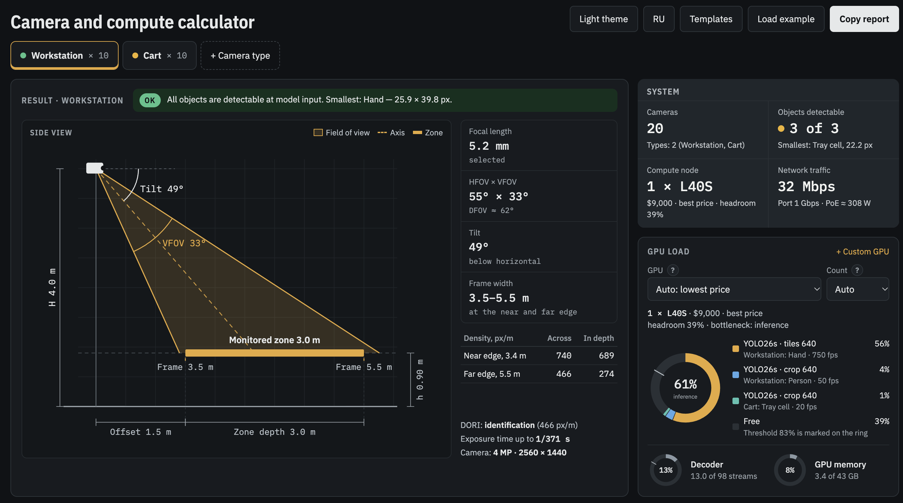

# Camera and compute calculator for video analytics

**English** · [Русский](README.ru.md)

A quick pre-project estimate of the hardware: which cameras and lenses to use, whether the model will see the object, and how many GPUs it takes.

**Open:** [sergeykrasnoslobodtsev.github.io/camera-calc](https://sergeykrasnoslobodtsev.github.io/camera-calc/) (English and Russian UI)



## Why

A video analytics project usually starts with requirements: what to detect, in which zone, from what distance. You have to pick cameras, lenses and a server right away, before there is a test bench or any measurements.

The calculator is for a quick ballpark estimate. It works from formulas and datasheet numbers, so it doesn't give an exact answer: on your hardware and your footage the numbers may differ.

## What it calculates

- **Object at model input.** How many pixels the object gets after scaling to the detector input, e.g. 640 px, in one of three feed modes: full frame, zone crop or tiles. The result is checked against the minimum object size threshold.
- **Camera and lens.** Camera height and tilt, monitored zone, focal length, field of view. Pixel density across and in depth, DORI levels per IEC 62676-4, and the exposure time at which a moving object doesn't blur.
- **Network.** Bitrate of H.264 and H.265 streams, PoE power.
- **Compute node.** Inference, NVDEC decoder and GPU memory load. Among the selected GPUs the calculator picks the cheapest configuration of 1 to 4 cards with the given headroom.
- **Report.** The summary as text, ready to paste into an email or a spec.

## Where the numbers come from

- **Models.** YOLO26 and YOLO11, detection and pose. GFLOPs and latency are taken from the published Ultralytics benchmarks: T4, TensorRT FP16, batch 1, 640 input.
- **GPUs.** Specs from NVIDIA datasheets: FP16 Tensor TFLOPS, NVDEC count, memory, TDP. Decoder throughput follows the NVIDIA Video Codec SDK 13.
- **Scaling to another card** is proportional to FP16 TFLOPS relative to the T4, with a derating factor. This is an approximation: real speed depends on the architecture, driver, batch size and the whole pipeline.
- **Prices** are a reference as of October 2026 and can be edited.

If the card or model you need isn't in the catalog, add it on the Templates page: your own GPU, camera or detector with your own speed measurement.

## Assumptions

- The lens is an ideal rectilinear one (pinhole camera), and the floor is a flat horizontal plane. The calculator doesn't model wide-angle lens distortion; you account for it manually with the quality factor k.
- All formulas are on the page, in the "All formulas" section.

## Data

Everything is computed in the browser, no data is sent anywhere. Templates and prices are stored in `localStorage`; to move them to another computer, use JSON export and import. The page builds into a single HTML file that opens without a server.

## Running locally

Requires Node 26.

```bash
npm install
npm run dev     # dev server
npm run build   # build dist/index.html
npm test        # type check, linter, tests
```

Stack: TypeScript, React, Vite, Vitest and Testing Library, Oxlint. The internal documentation in `docs/` is in Russian.

## Feedback

Bugs and suggestions go to [Issues](https://github.com/SergeyKrasnoslobodtsev/camera-calc/issues).

## License

[MIT](LICENSE)
