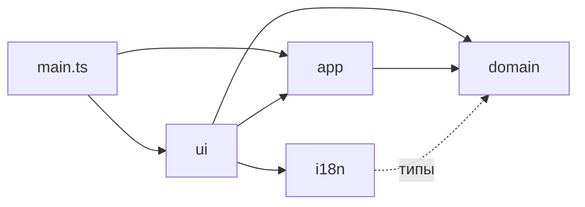
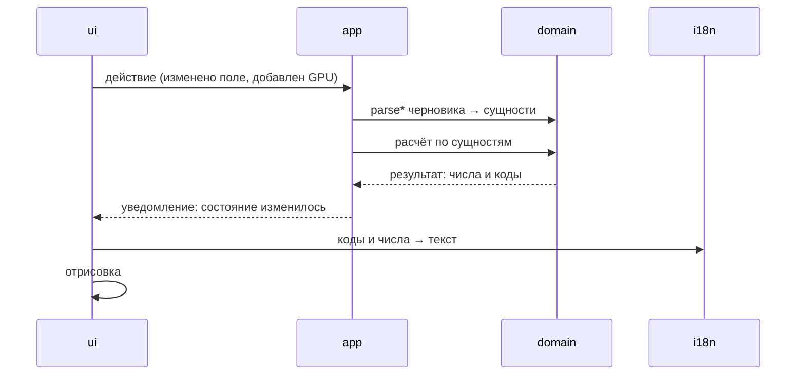

# Архитектура

Калькулятор — одна HTML-страница без сервера. По параметрам типов камер он считает геометрию кадра, плотность пикселей и размер объекта на входе модели, а по нагрузке подбирает GPU. Код делится на ядро расчёта и слои вокруг него: состояние, тексты, интерфейс.

!!! warning "Целевая структура"
    Ниже описана структура, к которой переходит код (задача #28). Сейчас расчёт типа камер, подбор GPU, итоги системы и справочники лежат в `src/domain/`, тексты — в `src/i18n/`, остальной код — в `src/js/` ES-модулями, перенесёнными из прежних файлов как есть. Всё собирается esbuild в один `<script>` (`build.ts`). Столбец «Сейчас» в таблице модулей показывает, где код находится до перехода. Когда переход закончится, столбец нужно удалить.

## Модули

| Модуль | Папка | Отвечает за | Сейчас |
|---|---|---|---|
| `domain` | `src/domain/` | Расчёт и сущности: справочники, разбор и проверка данных, расчёт типа камер, подачи в модель, вердикта, подбора GPU, сети и архива. Без DOM, без текстов, без `localStorage` | `src/domain/`; расчёт пока принимает черновики типа камер и параметров системы |
| `app` | `src/app/` | Состояние приложения в одном месте, действия над ним, пересчёт при изменении, сохранение, загрузка, импорт и экспорт | объект `store` в `store.js`; `save`, `load`, `importText`, `snapshot` в `system-ui.js` |
| `i18n` | `src/i18n/` | Словари RU и EN, функция `t()`, единицы измерения, форматирование чисел, перевод кодов из `domain` в текст | `src/i18n/` |
| `ui` | `src/ui/` | DOM: формы, карточки объектов, результат, панель системы, экраны шаблонов, схема SVG, текстовый отчёт, подсказки, уведомления, тема, маршрутизация | `state.js` (форма), `objects.js`, `system-ui.js`, `draw-side.js`, `popover.js` |
| точка входа | `src/main.ts` | Создаёт состояние, загружает сохранение, подключает интерфейс | `init.js` |
| `build` | `build.ts`, `tests/` | Сборка модулей в один HTML-файл `dist/camera-calc.html`, проверки: тесты, эталон, типы | `build.ts`, `tests/` (типов пока нет) |

Разметка и CSS остаются в `src/layout.html`, текст блока «Все формулы» — в `src/formulas.html` и `src/formulas.en.html`.

## Связи

Стрелка значит «импортирует», пунктир — «импортирует только типы» (`import type`, в сборку не попадает). Зависимости идут в одну сторону. `domain` не импортирует ничего из остальных модулей, `i18n` берёт из `domain` только типы результата, чтобы переводить его коды в текст. `app` не знает про DOM и тексты. Связывает коды из `domain` с текстами из `i18n` только `ui`.

## Поток данных

Сохранение, загрузка и импорт проходят через те же функции `parse*`, что и формы.

## Сквозные правила

- **Сырые данные проверяются на входе.** Форма, файл импорта и `localStorage` — это границы. Данные с них проходят через функции разбора сущности (`parseGpu`, `parseCamera` и т. д.) из `domain`. Для каждой сущности функция одна, и все границы пользуются ею. Внутрь попадают только проверенные значения с правильными типами.
- **`domain` возвращает коды, а не тексты.** Статус, заметки и причины ошибок передаются как код и значения, например `{ code: "zoneWidth", values: { have, need } }`. Текст собирает `i18n` по запросу `ui`. Встроенные названия (примеры, камеры из каталога) хранятся в `domain` как ключ, а отображаемое имя даёт `i18n`.
- **Глобальных переменных между модулями нет.** Связи между модулями видны только через `import` и `export`. Изменяемое состояние есть только в `app`.
- **Имена файлов в kebab-case, по назначению.** Числовых префиксов нет, порядок задают `import`.

## Выбор инструментов

Инструмент (сборщик, язык, библиотека, фреймворк) берётся, если выполнены два условия:

1. Калькулятор остаётся одной HTML-страницей, которая открывается из файла без сервера.
2. Инструмент упрощает код или работу с ним и уменьшает накладные расходы: меньше своего кода, языков, ручных шагов. Этот выигрыш должен перевешивать цену новой зависимости.

Правило задано владельцем проекта 2026-10-28. Конкретный выбор записывается в `decisions/` модуля вместе с тем, чем он проверен.

## Решения по модулям

- [`decisions/domain.md`](decisions/domain.md)
- [`decisions/app.md`](decisions/app.md)
- [`decisions/ui.md`](decisions/ui.md)
- [`decisions/build.md`](decisions/build.md)

Описание каждого модуля (`modules/<модуль>.md`) появляется вместе с самим модулем. Уже есть: [`modules/build.md`](modules/build.md), [`modules/domain.md`](modules/domain.md), [`modules/i18n.md`](modules/i18n.md).
