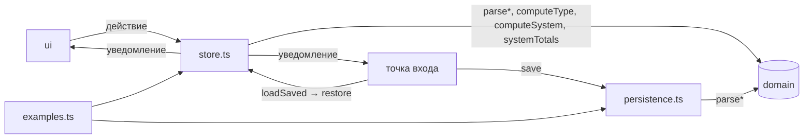
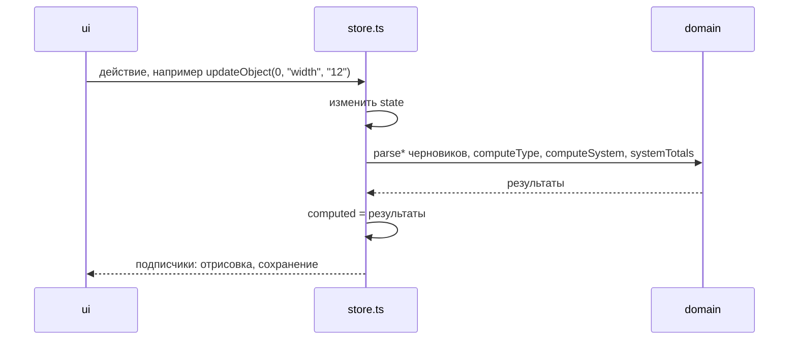

# Модуль app

Состояние приложения, действия над ним, пересчёт результатов, сохранение, загрузка, импорт и экспорт. Модуль не обращается к DOM и не знает текстов интерфейса. Из других модулей он импортирует только `domain`. Решения — в [`../decisions/app.md`](../decisions/app.md).

## Состав

| Файл | Что внутри |
|---|---|
| `store.ts` | Объект состояния `state`, результаты расчёта `computed`, подписка `subscribe` (возвращает отписку), действия и выборки (`activeType`, `allGpus`, `cameraById` и т. п.) |
| `persistence.ts` | Сохранение в `localStorage`, загрузка `loadSaved`, импорт `importText`, экспорт `exportText`, слежение за другими вкладками |
| `examples.ts` | Начальные данные: встроенный пример, объекты-пресеты, значения полей типа и параметров системы по умолчанию, `uid` |



## Состояние

Состояние одно на страницу (`state` в `store.ts`). Меняют его только действия из `store.ts`.

| Поле | Что хранит |
|---|---|
| `cameraTypes`, `activeTypeId` | Типы камер черновиком и id активного типа |
| `customGpus`, `customCameras`, `customDetectors` | Свои шаблоны: записи, прошедшие разбор |
| `gpuPrices`, `gpuEnabled` | Правки цен GPU как введены и участие в подборе по id GPU |
| `system` | Параметры системы черновиком: `efficiency`, `reserve`, `archiveDays`, `gpu`, `gpuCount` |
| `light` | Светлая тема |

**Черновик.** Поля типа камер, объектов и параметров системы хранятся так, как их ввёл пользователь: строками из полей формы или числами из шаблона. Перед расчётом черновик проходит через `parseCameraType` и `parseSystemSettings`. Сохраняется тоже черновик, поэтому после перезагрузки в поле возвращается введённая строка, даже недопустимая.

**Названия.** У встроенной записи (пример, пресет, камера из каталога) есть ключ словаря `nameKey`, а `name` пустое. Своё название лежит в `name`, и тогда `nameKey` нет. Если пользователь меняет встроенное название, действие убирает `nameKey`. Текст для показа даёт `displayName` из `i18n`: по `nameKey` на текущем языке, иначе `name`.

## Действие и пересчёт



Пересчитываются все результаты после каждого действия (`computed`):

| Поле `computed` | Что содержит |
|---|---|
| `results` | Результат по каждому типу в порядке `state.cameraTypes`. Если черновик не прошёл разбор — `{ ok: false, type, count }`, где `type` — черновик, а `count` — число камер, если оно допустимо, иначе 0 |
| `system` | Подбор GPU или `null`, если в параметрах системы или в цене карты ошибка |
| `totals` | Итоги системы; при ошибке в параметрах глубина архива — `NaN` |

Действие сохраняет связность ссылок в состоянии: если удалить свою карту, детекторы, замеренные на ней, переходят на RTX 5090, а выбор карты переключается на «авто». Если удалить камеру, типы с ней переходят на ручную матрицу. Если удалить детектор, объекты с ним переходят на YOLO26s.

## Сохранение, загрузка, импорт

| Операция | Правило |
|---|---|
| Сохранение | После каждого действия точка входа вызывает `save(state)`. Если данные изменили в другой вкладке, сохранение не выполняется, и `save` возвращает `false` |
| Загрузка | `loadSaved()` разбирает записи сохранения функциями `parse*` и пропускает те, что не прошли разбор. Черновик типа и параметров с недопустимым числом принимается (`onlyValueErrors`). Ссылки на то, чего нет, заменяются значением по умолчанию: модель объекта — YOLO26s, карта — «авто», число карт не из списка — «авто» |
| Импорт | `importText(text)` отклоняет файл целиком (`"badFile"`), если в нём нет нужных частей или хоть одна запись не прошла разбор. Принятый файл записывается в `localStorage` (`"ok"`), после чего интерфейс перезагружает страницу |
| Экспорт | `exportText(state)` — то же, что сохраняется, с отступами |

Старые сохранения с десятичной запятой (`"1,5"`) при загрузке и импорте приводятся к виду `"1.5"`.

## Соглашения

- **Изменения только через действия.** Вне `src/app/` поля `state` не присваиваются. Интерфейс читает `state` и `computed` и вызывает действия.
- **Отрисовка не зависит от порядка.** Подписчик рисует результаты. Функции, которые пересоздают разметку (`writeForm`, `renderObjects`), сами дорисовывают в неё результат из `computed`, поэтому их можно вызывать до уведомления или после.
- **Коды вместо текстов.** `importText` возвращает код (`"ok"`, `"badFile"`, `"saveFail"`), а текст сообщения выбирает интерфейс.

## Проверки

| Тест | Что проверяет |
|---|---|
| `tests/smoke.test.js` | Введённая строка сохраняется после перезагрузки; файл с недопустимой записью не импортируется, и сохранение не меняется; сохранение с недопустимой записью загружается без неё; недопустимые выбор карты и число карт при загрузке заменяются на «авто»; копия типа |
| `tests/golden.test.js` | Результаты расчёта на странице совпадают с `tests/golden.txt` |

Отсутствие присваиваний полям состояния вне `src/app/` проверяется поиском:

```bash
grep -rnE "(state|type|obj|object|detector|gpu|camera|inputs)(\.[A-Za-z_]+|\[[^]]+\])+ *(=[^=>]|\+\+|--|\+=|-=)|\.(push|splice|pop|shift|unshift|sort|reverse)\(|delete [a-z]" src/ui src/main.tsx
```

Он находит только сортировку и `push` локальных массивов при отрисовке кольца в `src/ui/system-panel.ts`.
