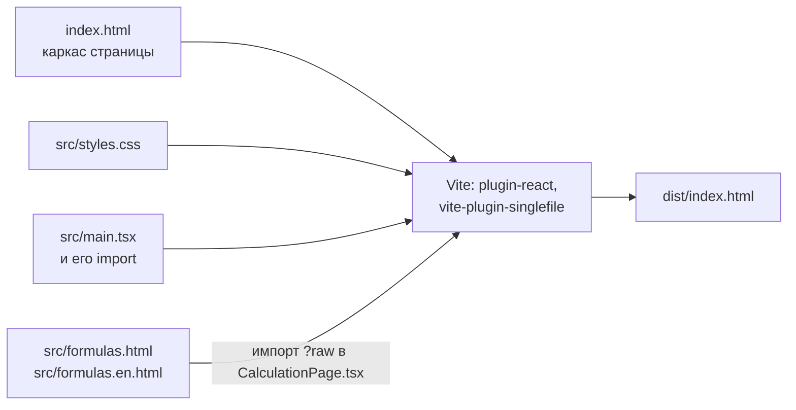
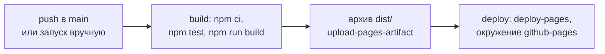

# Модуль build

Сборка исходников в одну страницу `dist/index.html`, линтер и проверки: тест страницы и тест-эталон. Решения и их обоснование — в [`../decisions/build.md`](../decisions/build.md).

## Сборка

`npm run build` запускает Vite по `vite.config.ts`. `npm run dev` запускает сервер разработки: страница пересобирается при правке исходников. `npm run preview` показывает собранную страницу.



| Шаг | Что делает |
|---|---|
| Формулы | `src/ui/calculation/CalculationPage.tsx` импортирует тексты RU и EN как строки (`?raw`); на странице показывается текст на языке интерфейса |
| Скрипт | Vite собирает модули от `src/main.tsx` в один минифицированный скрипт. `@vitejs/plugin-react` переводит JSX |
| Страница | `vite-plugin-singlefile` встраивает стили из `src/styles.css` в `<style>`, а скрипт — как `<script type="module">`. Внешних файлов нет, страница открывается из файловой системы |

## Публикация

Страница публикуется на GitHub Pages: https://sergeykrasnoslobodtsev.github.io/camera-calc/. `dist/` в репозитории не хранится (`.gitignore`).



| Часть | Что делает |
|---|---|
| `.github/workflows/static.yml` | Задание `build` ставит Node 26 и зависимости, запускает `npm test` и `npm run build`, загружает `dist/` архивом Pages. Задание `deploy` публикует архив. Тесты не прошли — публикации нет |
| Настройки репозитория | Pages: источник «GitHub Actions». Окружение `github-pages`: публиковать разрешено из `main` |

Страница лежит в подпапке `/camera-calc/`, но все ресурсы встроены в `index.html`, а адрес экрана хранится после `#`, поэтому путь подпапки сборке не нужен. `localStorage` у страницы на Pages свой, не тот, что у файла, открытого по `file://`: данные переносятся экспортом и импортом.

## Порядок выполнения модулей

Порядок, в котором выполняется код модулей при загрузке, задают `import`: модуль выполняется после тех, что он импортирует. При круговых импортах модуль, с которого начался круг, выполняется последним.

Круговых импортов в `src/` нет, кроме импортов только типов (`import type`), которые в сборку не попадают. Изменяемое состояние лежит в `src/app/store.ts`, и меняют его только действия оттуда (см. [`app.md`](app.md)).

## Проверки

`npm test` запускает проверку типов `tsc`, линтер `oxlint`, затем все тесты Vitest (`vitest run`). Собирать страницу перед тестами не нужно: тесты работают с исходниками. Почему Vitest и Testing Library — в [`../decisions/build.md`](../decisions/build.md#тесты-на-vitest-и-react-testing-library).

| Проверка | Что проверяет |
|---|---|
| `tsc` | Типы в `vite.config.ts`, `src/**/*.ts`, `src/**/*.tsx`, `tests/**/*.ts` и `tests/**/*.tsx` по `tsconfig.json`. Ничего не компилирует (`noEmit`): `.ts` выполняют Node и Vite, они типы только убирают |
| `oxlint` | Oxlint по `.oxlintrc.json`: ошибки категории `correctness` и правила хуков React; неиспользуемая переменная рядом с `...rest` не ошибка (`ignoreRestSiblings`), так из объекта убирают поле. Отдельно — `npm run lint` |
| `tests/domain/` | Юнит-тесты `domain` в окружении Node, без страницы, см. [`domain.md`](domain.md#проверки) |
| `tests/i18n/` | Словари `RU` и `EN`: одинаковые ключи; каждый ключ используется в `src/` или `index.html`, каждый используемый есть в словаре |
| `tests/page/` | Страница в jsdom, по файлу на тему: `templates` — свои камера, модель и объект детекции, форма камеры; `calculation` — подсказки у полей, копия типа; `export-import` — экспорт, импорт, загрузка сохранения, другая вкладка; `language` — выбор языка, отчёт на EN, названия; `inputs` — числовые поля и ошибки ввода |
| `tests/golden/` | Результаты расчёта для набора конфигураций совпадают с `tests/golden/golden.txt`. Эталон обновляется только после намеренного изменения расчёта: `npx vitest run tests/golden -u` |

```text
tests/
├── domain/        юнит-тесты расчёта
├── i18n/          словари
├── page/
│   ├── open-page.tsx   открыть страницу: отрисовка App через Testing Library
│   ├── helpers.js      действия и чтение страницы, свои шаблоны через формы
│   └── *.test.js       тесты по темам
└── golden/        тест-эталон и golden.txt
```

Данные страницы тесты берут так, как их видит пользователь: отчёт через кнопку «Копировать отчёт», состояние из `localStorage`. Глобальные переменные страницы тесты не читают. Файлы тестов не зависят друг от друга: данные, нужные нескольким тестам, файл готовит сам в `beforeAll`.

Тест страницы начинается строкой `// @vitest-environment jsdom`. `openPage` из `tests/page/open-page.tsx` открывает страницу как заново: размонтирует прежнюю, записывает сохранение и язык в `localStorage`, сбрасывает модули (`vi.resetModules`), запускает приложение через `start()` из `src/start.ts`, как `src/main.tsx`, и отрисовывает `App` функцией `render`. Модули загружаются заново, потому что язык читается из `localStorage` один раз, при загрузке модуля. Окно jsdom одно на файл, поэтому страницы открываются по очереди. Действия выполняются через `fireEvent`: он оборачивает событие в `act`, и React отрисовывает изменения до следующей строки теста. Перезагрузку страницы jsdom не выполняет, а сообщает об ошибке «Not implemented: navigation». `countReloads` из `tests/page/helpers.js` считает такие сообщения на `jsdom.virtualConsole`.

!!! warning "Собранная страница тестами не проверяется"
    Тесты работают с исходниками. Ошибку сборки (плагины Vite, встраивание скрипта в `dist/index.html`) они не заметят, её видно только при открытии `dist/index.html` в браузере.
