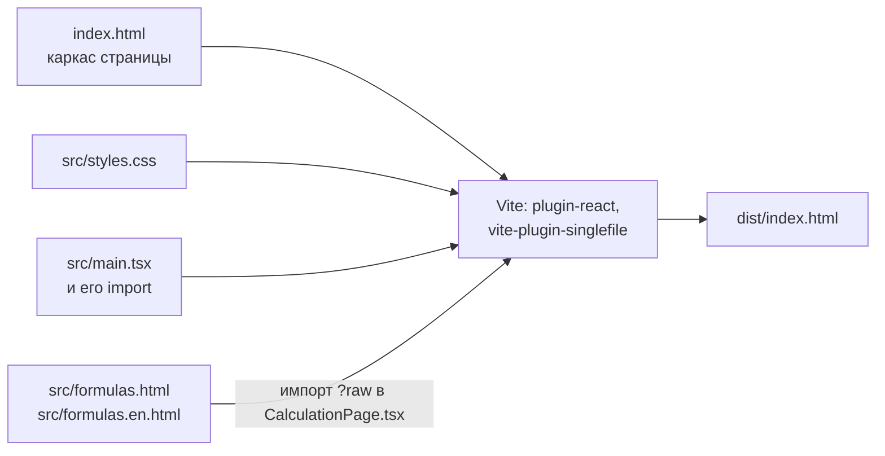

# Модуль build

Сборка исходников в одну страницу `dist/index.html`, линтер и проверки: тест страницы и тест-эталон. Решения и их обоснование — в [`../decisions/build.md`](../decisions/build.md).

## Сборка

`npm run build` запускает Vite по `vite.config.ts`. `npm run dev` запускает сервер разработки: страница пересобирается при правке исходников. `npm run preview` показывает собранную страницу.

| Шаг | Что делает |
|---|---|
| Формулы | `src/ui/calculation/CalculationPage.tsx` импортирует тексты RU и EN как строки (`?raw`); на странице показывается текст на языке интерфейса |
| Скрипт | Vite собирает модули от `src/main.tsx` в один минифицированный скрипт. `@vitejs/plugin-react` переводит JSX |
| Страница | `vite-plugin-singlefile` встраивает стили из `src/styles.css` в `<style>`, а скрипт — как `<script type="module">`. Внешних файлов нет, страница открывается из файловой системы |

Собранный `dist/index.html` пока хранится в репозитории, чтобы страницу можно было открыть без сборки. После публикации на GitHub Pages (#66) он уйдёт из репозитория.

## Порядок выполнения модулей

Порядок, в котором выполняется код модулей при загрузке, задают `import`: модуль выполняется после тех, что он импортирует. При круговых импортах модуль, с которого начался круг, выполняется последним.

Круговых импортов в `src/` нет, кроме импортов только типов (`import type`), которые в сборку не попадают. Изменяемое состояние лежит в `src/app/store.ts`, и меняют его только действия оттуда (см. [`app.md`](app.md)).

## Проверки

`npm test` запускает проверку типов, юнит-тесты и оба теста страницы по очереди и останавливается на первой ошибке. Перед ним нужен `npm run build`: тесты открывают собранную страницу. Линтер запускается отдельно, `npm run lint`: в старом коде есть замечания (см. [`../decisions/build.md`](../decisions/build.md#замечания-oxlint-в-старом-коде)).

| Проверка | Что проверяет |
|---|---|
| `tsc` | Типы в `vite.config.ts`, `src/**/*.ts`, `src/**/*.tsx` и `tests/**/*.ts` по `tsconfig.json`. Ничего не компилирует (`noEmit`): `.ts` выполняют Node и Vite, они типы только убирают |
| `npm run lint` | Oxlint по `.oxlintrc.json`: ошибки категории `correctness` и правила хуков React |
| `node --test tests/domain/` | Юнит-тесты `domain` без jsdom и без сборки, см. [`domain.md`](domain.md#проверки) |
| `tests/smoke.test.js` | Страница в jsdom: отчёт, шаблоны, добавление камеры и детектора, экспорт и импорт, язык. Словари `RU` и `EN` импортирует из `src/i18n/` напрямую и сравнивает их ключи |
| `tests/golden.test.js` | Результаты расчёта для набора конфигураций совпадают с `tests/golden.txt`. Эталон обновляется только после намеренного изменения расчёта: `node tests/golden.test.js --update` |

Данные страницы тесты берут так, как их видит пользователь: отчёт через кнопку «Копировать отчёт», состояние из `localStorage`. Глобальные переменные страницы тесты не читают.

Тесты страницы открывают её через `tests/page.js`. jsdom не выполняет `<script type="module">`, поэтому `runModuleScripts` добавляет текст скрипта в конец страницы обычным `<script>`. React отрисовывает не сразу: после действия, которое меняет то, что рисует React, тест ждёт `await settle(window)`.
