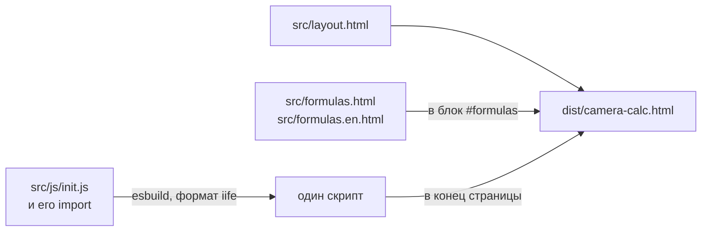

# Модуль build

Сборка исходников в одну страницу `dist/camera-calc.html` и проверки: тест страницы и тест-эталон. Решения и их обоснование — в [`../decisions/build.md`](../decisions/build.md).

## Сборка

`npm run build` запускает `build.ts` на Node. Node выполняет TypeScript без отдельной компиляции.

| Шаг | Что делает |
|---|---|
| Формулы | Тексты RU и EN оборачиваются в `
` и `
` и вставляются в пустой блок `
` разметки. Нет блока — сборка падает |
| Скрипт | esbuild собирает модули из точки входа `src/js/init.js` в один скрипт `iife` без минификации, кириллица остаётся как есть (`charset: utf8`). Настройки TypeScript esbuild берёт из `tsconfig.json`: из-за `strict` скрипт начинается с `"use strict"`, как и положено модулям |
| Страница | Разметка с формулами, затем `<script>` со скриптом. Внешних файлов нет, страница открывается из файловой системы |

Собранный `dist/camera-calc.html` хранится в репозитории, чтобы страницу можно было открыть без сборки.

## Порядок выполнения модулей

Порядок, в котором выполняется код модулей при загрузке, задают `import`: модуль выполняется после тех, что он импортирует. При круговых импортах модуль, с которого начался круг, выполняется последним.

`src/js/state.js`, `src/js/objects.js` и `src/js/system-ui.js` импортируют друг друга по кругу, а `system-ui.js` при загрузке читает `OBJECT_PRESETS` из `state.js`. Поэтому `init.js` импортирует `system-ui.js` раньше `state.js`.

!!! warning "Порядок импортов в `init.js`"
    Если в `init.js` поставить импорт `state.js` первым, `system-ui.js` выполнится раньше `state.js` и обратится к `OBJECT_PRESETS` до объявления. Тест страницы и тест-эталон на этом упадут.

Изменяемое состояние, которое присваивают несколько модулей, лежит в одном объекте `store` (`src/js/store.js`). Импортированную переменную присвоить нельзя, а поле объекта можно.

## Проверки

`npm test` запускает проверку типов, юнит-тесты и оба теста страницы по очереди и останавливается на первой ошибке. Перед ним нужен `npm run build`: тесты открывают собранную страницу.

| Проверка | Что проверяет |
|---|---|
| `tsc` | Типы в `build.ts`, `src/**/*.ts` и `tests/**/*.ts` по `tsconfig.json`. Ничего не компилирует (`noEmit`): `.ts` выполняют Node и esbuild, они типы только убирают. Файлы `.js` не проверяются |
| `node --test tests/domain/` | Юнит-тесты `domain` без jsdom и без сборки, см. [`domain.md`](domain.md#проверки) |
| `tests/smoke.test.js` | Страница в jsdom: отчёт, шаблоны, добавление камеры и детектора, экспорт и импорт, язык. Словари `RU` и `EN` импортирует из `src/i18n/` напрямую и сравнивает их ключи |
| `tests/golden.test.js` | Результаты расчёта для набора конфигураций совпадают с `tests/golden.txt`. Эталон обновляется только после намеренного изменения расчёта: `node tests/golden.test.js --update` |

Данные страницы тесты берут так, как их видит пользователь: отчёт через кнопку «Копировать отчёт», состояние из `localStorage`. Глобальные переменные страницы тесты не читают.
