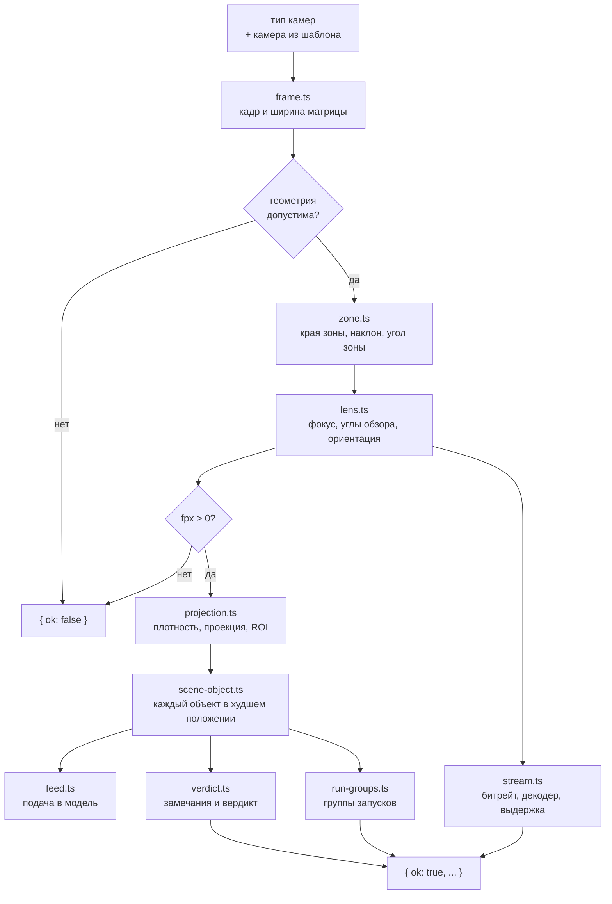

# Модуль domain

Ядро расчёта: сущности, справочники и расчёт одного типа камер. Модуль не обращается к DOM, `localStorage` и текстам интерфейса и не импортирует другие модули проекта. Решения и известные проблемы — в [`../decisions/domain.md`](../decisions/domain.md). Формулы для пользователя — в блоке «Все формулы» (`src/formulas.html`).

!!! note "Переход не закончен"
    Подбор GPU и итоги системы пока считаются в `src/js/system-ui.js` (#47), функции разбора сущностей ещё не написаны (#48). Значения полей типа камер приходят строками из формы и разбираются при расчёте (`parseNum`).

## Состав

| Папка, файл | Что внутри |
|---|---|
| `entities/` | Типы сущностей: `CameraType`, `SceneObject`, `Camera`, `Gpu`, `CatalogModel`, `CustomDetector` |
| `references/` | Справочники: разрешения, форматы матрицы, каталог GPU и ёмкость декодера `decodableStreams`, модели Ultralytics, встроенные камеры |
| `compute-type/` | Расчёт типа камер `computeType(type, camera)`, по шагу на файл |
| `angles.ts`, `parse-num.ts` | `DEG` и разбор числа из поля формы |

Встроенные записи хранят не название, а ключ словаря (`nameKey: "builtinCameraNames.k4"`). Название на текущем языке подставляет интерфейс.

## Расчёт типа камер

`computeType(type, camera)` получает тип камер и камеру из шаблона, которую он выбрал (или `undefined`), и возвращает `TypeResult`. Справочники берутся из `references/` импортом: это неизменяемые константы, а не состояние.

| Шаг | Что считает |
|---|---|
| `frame.ts` | Кадр $N_w \times N_h$ и ширину матрицы $s$: из камеры шаблона, иначе из разрешения и формата матрицы (по размеру пикселя $p$ в мкм $s = p \cdot N_w / 1000$ или своя ширина) |
| `zone.ts` | Края зоны $x_1, x_2$ по полу: над центром $x_1 = -d/2$, сбоку $x_1$ — вынос. Ось камеры — в середине угла зоны: $\text{tilt} = (\varphi_1 + \varphi_2)/2$, $\varphi = \operatorname{atan2}(H_c, x)$ |
| `lens.ts` | Подбор: угол обзора под зону с запасом, фокус ограничивается диапазоном объектива. Заданный фокус или угол — пересчёт второго. Ориентация «авто» в подборе выбирает портрет, если $f_{px}$ больше в 1,02 раза, при заданном объективе — альбомную, если зона в ней помещается |
| `projection.ts` | Плотность пикселей поперёк и вглубь в 41 точке зоны, проекция точки в кадр, рамка коробки объекта, область зоны в кадре (ROI) |
| `scene-object.ts` | Объект проходит 41 положение в зоне, берётся то, где меньшая сторона рамки наименьшая. Статус по входу модели: не меньше порога — `ok`, от 75 % порога — `warn`, ниже — `bad` |
| `feed.ts` | Подача: весь кадр или вырез зоны уменьшаются до входа модели, тайлы покрывают ROI с шагом $\text{input} \cdot (1 - \text{overlap})$ |
| `verdict.ts` | Замечания к геометрии, объективу и потоку, вердикт по объектам и советы: какое разрешение нужно и до какого входа увеличить модель |
| `run-groups.ts` | Объекты с одной моделью, подачей и входом — один запуск; нагрузка — камеры × частота аналитики × тайлы |
| `stream.ts` | Кодек по битам на пиксель, битрейт, нагрузка на декодер в потоках 1080p@30, размер декодированного кадра, выдержка без смаза |

## Результат

| Поле | Содержимое |
|---|---|
| `ok` | `false` — ошибка ввода: есть только `type`, `count`, `frame` |
| `frame`, `count`, `placement` | Кадр до поворота камеры, число камер, положение камеры |
| `geometry` | Исходные размеры, края и наклон зоны, ширина кадра у ближнего и дальнего края |
| `lens` | Фокус и нужный фокус, углы обзора, $f_{px}$, поворот, кадр с учётом поворота, режим, упор в объектив |
| `density` | Плотность на краях зоны, минимумы поперёк и вглубь, максимум |
| `stream`, `shutterDenominator` | Поток камеры и выдержка не длиннее $1/\text{shutterDenominator}$ с |
| `objects` | По объекту: `{ valid: false }` без габаритов или порога, иначе рамка, размер на входе модели, статус |
| `notes`, `verdict`, `status` | Замечания и вердикт кодами, итоговый статус типа |
| `runGroups` | Запуски моделей для подбора GPU |

Заметка — `{ code, values }`, вердикт — `{ code, ... }`, оба — размеченные объединения (`Note`, `Verdict` в `verdict.ts`): по `code` TypeScript знает форму `values`. Текст по ним собирает `src/i18n/domain-text.ts`. Заметки-советы и вердикт ссылаются на объект из `objects` того же результата.

## Соглашения

- **Единицы.** Внутри расчёта длины в метрах, фокус в миллиметрах, углы в радианах, размеры в кадре в пикселях. В `values` заметок углы уже в градусах. Габариты объекта в полях — в сантиметрах, переводятся в метры при разборе.
- **Обозначения** в коде совпадают с формулами: $H$, $h$, $H_c = H - h$, $x_1$, $x_2$, $f$, $f_{px}$, $k$. Расшифровка — в шапке `compute-type/index.ts`.
- **Константы** объявлены именованными рядом с местом использования, источник указан в комментарии. Значения без источника перечислены в [`decisions/domain.md`](../decisions/domain.md#пороги-без-источника).

## Проверки

| Тест | Что проверяет |
|---|---|
| `tests/domain/compute-type.test.ts` | Результат совпадает с прежней реализацией на 30 конфигурациях с допуском $10^{-9}$, включая тексты на русском. Фикстура `tests/domain/fixtures/compute-type.json` снята один раз со старого `computeType` (коммит 7cca661) и не перегенерируется |
| `geometry.test.ts`, `objects.test.ts`, `stream.test.ts` | Шаги расчёта на случаях, которые считаются вручную |
| `boundaries.test.ts` | В `src/domain/` нет `document`, `window`, `localStorage`, `navigator` и импортов за пределы папки |
