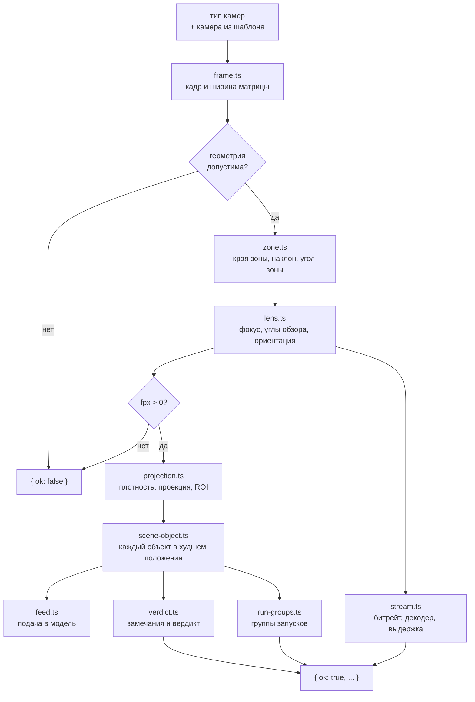
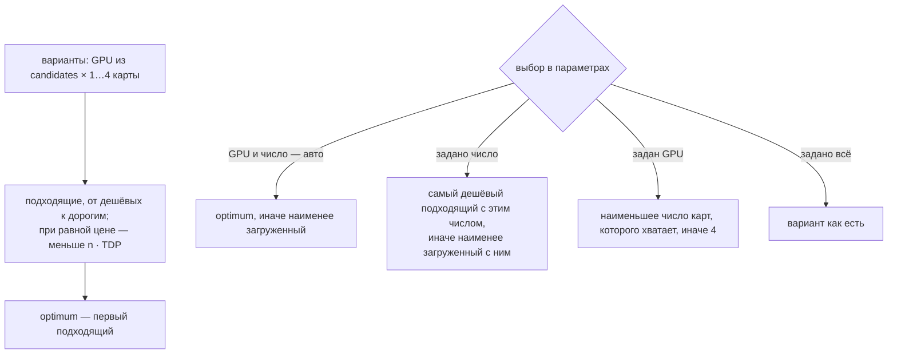

# Модуль domain

Ядро расчёта: сущности, справочники, расчёт одного типа камер, подбор GPU и итоги системы. Модуль не обращается к DOM, `localStorage` и текстам интерфейса и не импортирует другие модули проекта. Решения и известные проблемы — в [`../decisions/domain.md`](../decisions/domain.md). Формулы для пользователя — в блоке «Все формулы» (`src/formulas.html`).

!!! note "Переход не закончен"
    Недопустимое число в черновике типа камер, объекта или параметров системы пока не даёт ошибку поля. Разбор превращает его в `NaN` или подставляет значение по умолчанию, а ошибку ввода показывает расчёт. Замена на ошибку поля — #36.

## Состав

| Папка, файл | Что внутри |
|---|---|
| `entities/` | Типы сущностей: `CameraType`, `SceneObject`, `Camera`, `Gpu`, `CatalogModel`, `CustomDetector`, `SystemSettings` и функции их разбора; общие правила полей — `parse-result.ts` |
| `references/` | Справочники: разрешения, форматы матрицы, каталог GPU и ёмкость декодера `decodableStreams`, модели Ultralytics, встроенные камеры |
| `compute-type/` | Расчёт типа камер `computeType(type, camera)`, по шагу на файл |
| `compute-system/` | Подбор GPU `computeSystem` (`index.ts`, нагрузка варианта — `gpu-load.ts`) и итоги системы `systemTotals` (`totals.ts`) |
| `angles.ts`, `parse-num.ts` | `DEG` и разбор числа из поля формы |

Встроенные записи хранят не название, а ключ словаря (`nameKey: "builtinCameraNames.k4"`). Название на текущем языке подставляет интерфейс.

## Разбор сущностей

Сырая запись из формы, сохранения или файла импорта проходит через функцию разбора своей сущности. Результат — `{ ok: true, value }` или `{ ok: false, errors }`, ошибка — `{ field, code }`. В `value` попадают только известные поля. Вложенное поле пишется путём: `decodeStreams.h265`, `inputs.placement`, `objects.1.feed`.

| Функция | Проверяет |
|---|---|
| `parseGpu` | `id`, `name` — непустые строки; `arch` из списка; `tflops`, `memoryGB`, `price` > 0; `tdpW` ≥ 0; у Jetson `decodeStreams.h264`, `decodeStreams.h265` > 0, у остальных `nvdec` > 0 |
| `parseCamera` | `id`, `name` — непустые строки; `Nw`, `Nh`, `sensorWidth` > 0; `focalMin`, `focalMax` ≥ 0 и `focalMin` ≤ `focalMax`; `price`, если есть, ≥ 0 |
| `parseDetector` | `id`, `name`, `refGpu` — непустые строки; `fps`, `inputSize` > 0; `gflops` ≥ 0 |
| `parseSceneObject` | черновик: `name` — строка, `model` — непустая строка, `feed` из `"full"`, `"roi"`, `"tiles"`, числовые поля — строка или число; без `inputSize` — 640, без `overlap` — 0 |
| `parseCameraType` | черновик: `id` — непустая строка, `name` — строка, `count` и числовые поля `inputs` — строка или число, `orientation`, `lensMode`, `placement` из списков, каждый объект — `parseSceneObject`; `count` — целое ≥ 0, без значения — 0; `margin` без значения — 0 |
| `parseSystemSettings` | черновик: пять полей — строки; `reserve` ≥ 0, без значения — 0; `archiveDays` без значения — 0; `gpuCount` — `"auto"` или число |

Коды правил: `required` — нет значения нужного вида или пустая строка, `positive` — не число > 0, `nonNegative` — не число ≥ 0, `oneOf` — значение не из списка, `order` — нарушен порядок значений. У GPU, камеры и детектора числа из строк не разбираются: поле-строка — ошибка. Формы шаблонов переводят ввод в числа сами (`parseNum`) и подставляют значения по умолчанию, например TDP 0, до разбора.

Тип камер, объект и параметры системы хранятся черновиком: строки из формы или числа из шаблона. Их функции разбора переводят числа в `value` для расчёта: `parseNum` (десятичная запятая допускается, не число — `NaN`), а для индексов и значений списков `resolution`, `sensor`, `codec`, `scene`, `gpuCount` — `Number` (пустая строка — 0). Store и сохранение остаются при черновике, в расчёт идёт только `value`.

## Расчёт типа камер

`computeType(type, camera)` получает тип камер и камеру из шаблона, которую он выбрал (или `undefined`), и возвращает `TypeResult`. Справочники берутся из `references/` импортом: это неизменяемые константы, а не состояние.

| Шаг | Что считает |
|---|---|
| `frame.ts` | Кадр $N_w \times N_h$ и ширину матрицы $s$: из камеры шаблона, иначе из разрешения и формата матрицы (по размеру пикселя $p$ в мкм $s = p \cdot N_w / 1000$ или своя ширина) |
| `zone.ts` | Края зоны $x_1, x_2$ по полу: над центром $x_1 = -d/2$, сбоку $x_1$ — вынос. Ось камеры — в середине угла зоны: $\text{tilt} = (\varphi_1 + \varphi_2)/2$, $\varphi = \operatorname{atan2}(H_c, x)$ |
| `lens.ts` | Подбор: угол обзора под зону с запасом, фокус ограничивается диапазоном объектива. Заданный фокус или угол — пересчёт второго. Ориентация «авто» в подборе выбирает портрет, если $f_{px}$ больше в 1,02 раза, при заданном объективе — альбомную, если зона в ней помещается |
| `projection.ts` | Плотность пикселей поперёк и вглубь в 41 точке зоны, проекция точки в кадр, рамка коробки объекта, область зоны в кадре (ROI) |
| `scene-object.ts` | Объект проходит 41 положение в зоне, берётся то, где меньшая сторона рамки наименьшая. Статус по входу модели: не меньше порога — `ok`, от 75 % порога — `warn`, ниже — `bad` |
| `feed.ts` | Подача: весь кадр или вырез зоны уменьшаются до входа модели, тайлы покрывают ROI с шагом $\text{input} \cdot (1 - \text{overlap})$ |
| `verdict.ts` | Замечания к геометрии, объективу и потоку, вердикт по объектам и советы: какое разрешение нужно и до какого входа увеличить модель |
| `run-groups.ts` | Объекты с одной моделью, подачей и входом — один запуск; нагрузка — камеры × частота аналитики × тайлы |
| `stream.ts` | Кодек по битам на пиксель, битрейт, нагрузка на декодер в потоках 1080p@30, размер декодированного кадра, выдержка без смаза |

## Результат

| Поле | Содержимое |
|---|---|
| `ok` | `false` — ошибка ввода: есть только `type`, `count`, `frame` |
| `frame`, `count`, `placement` | Кадр до поворота камеры, число камер, положение камеры |
| `geometry` | Исходные размеры, края и наклон зоны, ширина кадра у ближнего и дальнего края |
| `lens` | Фокус и нужный фокус, углы обзора, $f_{px}$, поворот, кадр с учётом поворота, режим, упор в объектив |
| `density` | Плотность на краях зоны, минимумы поперёк и вглубь, максимум |
| `stream`, `shutterDenominator` | Поток камеры и выдержка не длиннее $1/\text{shutterDenominator}$ с |
| `objects` | По объекту: `{ valid: false }` без габаритов или порога, иначе рамка, размер на входе модели, статус |
| `notes`, `verdict`, `status` | Замечания и вердикт кодами, итоговый статус типа |
| `runGroups` | Запуски моделей для подбора GPU |

Заметка — `{ code, values }`, вердикт — `{ code, ... }`, оба — размеченные объединения (`Note`, `Verdict` в `verdict.ts`): по `code` TypeScript знает форму `values`. Текст по ним собирает `src/i18n/domain-text.ts`. Заметки-советы и вердикт ссылаются на объект из `objects` того же результата.

## Подбор GPU

`computeSystem(results, settings, catalog)` получает результаты всех типов камер, параметры системы и справочник пользователя `catalog`:

| Поле `catalog` | Что это |
|---|---|
| `gpus` | Каталог и свои карты с действующей ценой (правка цены уже применена). Первая — запасная, если GPU не найден |
| `candidates` | Карты из `gpus`, включённые в подбор |
| `detectors` | Свои детекторы. Модели каталога берутся из `references/models.ts` |

В подборе участвуют типы без ошибки и с камерами (`liveResults`). Их группы запусков складываются: нагрузка инференса — сумма по всем запускам всех типов. Модель с одним входом — один движок в памяти GPU, сколько бы типов её ни запускали.

Для каждого GPU из `candidates` и $n = 1 \ldots 4$ карт `evaluateGpu` считает загрузку трёх ресурсов, $\eta$ — эффективность из параметров:

$$
\text{инференс} = \frac{1}{n} \sum_{\text{запуски}} \frac{\text{нагрузка}}{\text{кадр/с модели} \cdot \eta},
\qquad
\text{декодер} = \frac{1}{n} \sum_{\text{типы}} \frac{\text{потоки 1080p@30}}{\text{ёмкость декодера} \cdot \eta}
$$

$$
\text{память} = \frac{0{,}8 + \sum_{\text{движки}} m + \sum_{\text{типы}} \lceil \text{камер} / n \rceil \cdot 20 \cdot \text{кадр, ГБ}}{\text{память GPU} \cdot 0{,}9 \text{ (Jetson } 0{,}6)}
$$

Кадров в секунду модели каталога — $\frac{1000}{\text{задержка на T4}} \cdot \left(\frac{640}{\text{вход}}\right)^2 \cdot \frac{\text{TFLOPS}}{65}$; своего детектора — $\text{замер} \cdot \left(\frac{\text{вход замера}}{\text{вход}}\right)^2 \cdot \frac{\text{TFLOPS}}{\text{TFLOPS GPU замера}}$. Память движка $m = 0{,}15 + 16 \cdot \text{вход}^2 \cdot 6 \cdot \frac{\text{GFLOPs}}{4} / 10^9$ ГБ, при неизвестных GFLOPs — 0,5 ГБ. Модель, которой нет ни в каталоге, ни среди своих детекторов, помечается `unknownModel` и в нагрузку не входит.

Вариант подходит, если инференс и декодер не больше $1 / (1 + \text{запас})$, а память не больше 100 %. Узкое место — ресурс с наибольшей загрузкой.

Если в подборе нет ни одного GPU, выбирается одна карта `gpus[0]` и ставится `noCandidates`.

| Поле результата | Содержимое |
|---|---|
| `liveResults`, `efficiency`, `maxLoad` | Типы в подборе, эффективность, наибольшая допустимая загрузка инференса и декодера |
| `chosen`, `optimum` | Вариант по выбору в параметрах и самый дешёвый подходящий (`undefined`, если не подходит ни один) |
| `decodeUnitsTotal` | Нагрузка на декодер всех типов в потоках 1080p@30 |
| `noCandidates` | В подборе нет ни одного GPU |

Вариант (`GpuOption`): GPU и число карт, запуски с ёмкостью и долей GPU (`runs`), загрузка трёх ресурсов и худшая из них, память в ГБ, `ok`, стоимость `count × price`, узкое место кодом `"inference" | "decoder" | "memory"`.

## Итоги системы

`systemTotals(results, settings, cameras)` считает по всем типам число камер и стоимость камер из шаблонов с ценой (`cameras` — камеры шаблонов). Поток и архив считает только по типам без ошибки:

| Поле | Формула |
|---|---|
| `totalMbps` | $\sum \text{битрейт} \cdot \text{камер}$, Мбит/с |
| `port` | `"1G"`, если $\text{поток} \cdot 1{,}3 < 900$ Мбит/с; `"10G"`, если $< 9000$; иначе `"over10G"` |
| `poeW` | $\text{камер} \cdot 15{,}4$ Вт (IEEE 802.3af) |
| `archiveTB` | $\text{поток} \cdot 10^6 / 8 \cdot 86\,400 \cdot \text{суток} / 10^{12}$ |

Текст узкого места и порта собирает `src/i18n/domain-text.ts` (`bottleneckText`, `portText`).

## Соглашения

- **Единицы.** Внутри расчёта длины в метрах, фокус в миллиметрах, углы в радианах, размеры в кадре в пикселях. В `values` заметок углы уже в градусах. Габариты объекта в полях — в сантиметрах, переводятся в метры в расчёте объекта (`evaluateObject`).
- **Обозначения** в коде совпадают с формулами: $H$, $h$, $H_c = H - h$, $x_1$, $x_2$, $f$, $f_{px}$, $k$. Расшифровка — в шапке `compute-type/index.ts`.
- **Константы** объявлены именованными рядом с местом использования, источник указан в комментарии. Значения без источника перечислены в [`decisions/domain.md`](../decisions/domain.md#пороги-без-источника).

## Проверки

| Тест | Что проверяет |
|---|---|
| `tests/domain/compute-type.test.ts` | Результат совпадает с прежней реализацией на 30 конфигурациях с допуском $10^{-9}$, включая тексты на русском. Фикстура `tests/domain/fixtures/compute-type.json` снята один раз со старого `computeType` (коммит 7cca661) и не перегенерируется |
| `geometry.test.ts`, `objects.test.ts`, `stream.test.ts` | Шаги расчёта на случаях, которые считаются вручную |
| `compute-system.test.ts` | Нагрузка инференса, декодера и памяти, выбор варианта по параметрам, итоги и порт на случаях, которые считаются вручную |
| `entities.test.ts` | Каждая функция разбора: допустимые данные, каждое правило поля, лишние поля |
| `boundaries.test.ts` | В `src/domain/` нет `document`, `window`, `localStorage`, `navigator` и импортов за пределы папки |
