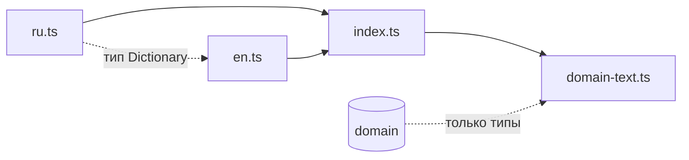

# Модуль i18n

Тексты интерфейса на русском и английском, выбор языка, форматирование чисел и перевод результатов `domain` в текст. Правила формулировок — в `docs/ui-text-rules.md`.

## Состав

| Файл | Что внутри |
|---|---|
| `ru.ts` | Словарь `RU` и его тип `Dictionary`. Значение — строка, массив, вложенный словарь или функция от параметров |
| `en.ts` | Словарь `EN`, объявлен с типом `Dictionary` |
| `index.ts` | Язык `LANG`, словарь текущего языка `STR`, `t()`, `withUnit()`, `formatNumber()`, `displayName()` — название записи для показа: встроенное по ключу `nameKey` на текущем языке, иначе своё `name`. Встроенные названия — в группах словаря `typeNames`, `builtinCameraNames`, `builtinObjectNames` |
| `domain-text.ts` | Текст по кодам и числам из `domain`: заметки, вердикт и плашка вердикта, подача, размер объекта на матрице и на входе модели, подпись разрешения, название объекта — название его объекта детекции, а если оно пустое — «Объект» (`objDefault`) |

`domain-text.ts` берёт из `domain` только типы (`import type`): в собранную страницу код `domain` через него не попадает, и `domain` по-прежнему ничего не знает о текстах.

## Проверка словарей типами

- `EN` объявлен с типом словаря `RU`. Если ключа не хватает, есть лишний или у функции другие параметры, `tsc` выдаёт ошибку. Повторяющийся ключ в литерале — тоже ошибка `tsc` (TS1117).
- `t(key, ...params)` выводит параметры из словаря: неизвестный ключ и неверное число параметров находит `tsc`. Ключ, который приходит из разметки или таблицы кодов, имеет тип `TextKey` — ключ текста без параметров. Что каждый ключ словаря где-то используется, проверяет `tests/i18n/dictionaries.test.js`.
- В `domain-text.ts` текст заметки и вердикта выбирается через `switch` по `code`. Если в `domain` появится новый код без текста, `tsc` сообщит, что функция возвращает не на всех путях.

## Язык и числа

Язык выбирается при загрузке страницы, по первому подходящему источнику:

1. параметр адреса `?lang=ru` или `?lang=en`;
2. выбор, сохранённый в `localStorage` (`camcalc-lang`);
3. первый язык из `navigator.languages` (затем `navigator.language`), который начинается с `ru` или `en`: для `["uk", "ru", "en"]` — русский, для `["en-US", "ru"]` — английский;
4. английский.

Смена языка сохраняет выбор в `localStorage` и перезагружает страницу. Если записать в `localStorage` нельзя (приватный режим, заблокированные данные сайта), язык передаётся в адресе (`?lang=`); после успешной записи параметр из адреса убирается, иначе он перекрыл бы сохранённый выбор. Если язык сменили в другой вкладке, текущая вкладка показывает уведомление «Язык изменён в другой вкладке. Обновите страницу.» и остаётся на своём языке до обновления.

`formatNumber(value, digits)` форматирует по правилам языка (`ru-RU` или `en-US`) с заданным числом знаков после запятой и типографским минусом. Не число выводится как «—». `withUnit(value, unit)` ставит единицу из словаря через неразрывный пробел.

Всю разметку страницы отрисовывают компоненты `ui`, тексты они берут из `t()`. Язык и заголовок документа ставит `src/main.tsx`: это работа с DOM, поэтому она не в `i18n`.
