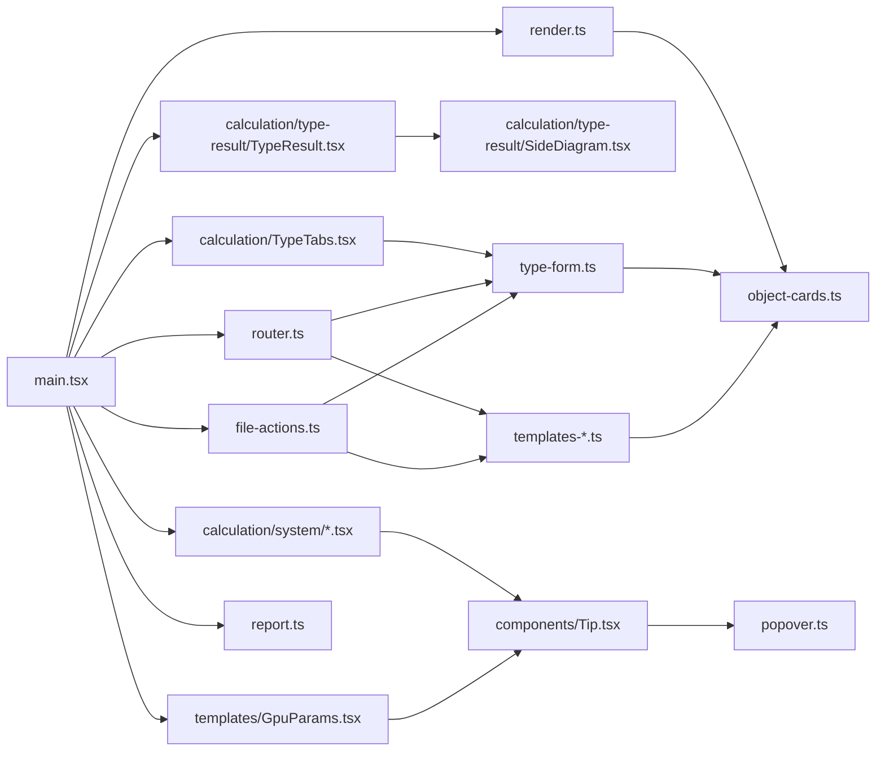
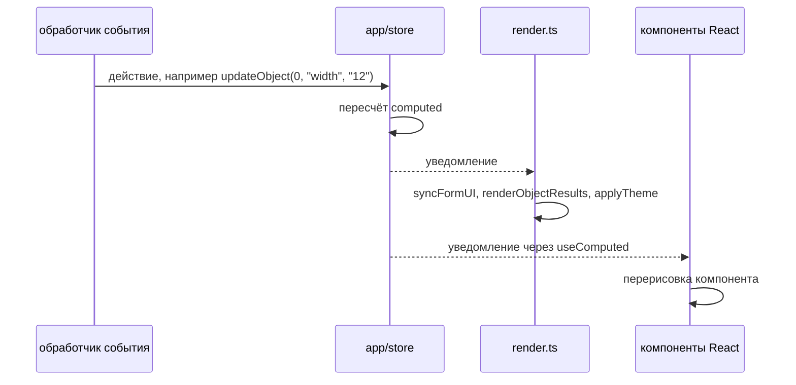

# Модуль ui

Всё, что работает с DOM: форма типа камер, карточки объектов, результат, вкладки, панель системы, экраны шаблонов, схема SVG, текстовый отчёт, подсказки, уведомления, тема, язык и маршрутизация. Состояние модуль берёт из `app` и меняет только через его действия. Тексты берёт из `i18n`, справочники и функции разбора — из `domain`. Решения — в [`../decisions/ui.md`](../decisions/ui.md).

## Раскладка

Целевая раскладка `src/ui/` после перехода на React (#65). Папки — по частям экрана, общие компоненты, хуки и функции без React — отдельно. Каждый шаг перехода кладёт новые компоненты на их место и удаляет старый файл; файлы на `innerHTML` до переписывания остаются в корне `src/ui/`.

```
src/ui/
├── App.tsx                  корень: шапка, «расчёт» или «шаблоны» по адресу
├── header/                  Header.tsx — тема, язык, шаблоны, пример, отчёт; file-actions.ts
├── calculation/
│   ├── TypeTabs.tsx         вкладки типов камер
│   ├── type-form/           TypeForm.tsx, ObjectCard.tsx
│   ├── type-result/         TypeResult.tsx, SideDiagram.tsx
│   └── system/              SystemPanel.tsx, GpuLoad.tsx, NetworkPanel.tsx, Assumptions.tsx
├── templates/               TemplatesPage.tsx, GpuTemplates.tsx, GpuParams.tsx,
│                            CameraTemplates.tsx, DetectorTemplates.tsx, form-errors.ts
├── components/              общие компоненты: Toast.tsx, Tip.tsx (подсказка «?»)
├── hooks/                   useComputed.ts, useHashRoute.ts
└── lib/                     функции без React: report.ts, labels.ts
```

`render.ts`, `translations.ts` и `dom.ts` после перехода не нужны: отрисовку по состоянию делает React, тексты компоненты берут из `t()`.

## Состав

Файлы сейчас.

| Файл | Что внутри |
|---|---|
| `dom.ts` | `byId` — элемент по id с типом элемента, `escapeHtml`, тип поля формы `Field` |
| `labels.ts` | Подписи, общие для результата, панели системы и отчёта: название модели объекта, камера типа |
| `type-form.ts` | Форма типа камер: `writeForm` (тип → поля), `readForm` (поля → действие `updateActiveType`), кнопки «копия» и «удалить тип» |
| `object-cards.ts` | Список камер в форме (`buildCameraSelect`), карточки объектов и их результат, `syncFormUI` — видимость полей и сводка над формой, кнопки добавления объекта |
| `calculation/TypeTabs.tsx` | Компонент `TypeTabs`: вкладки типов камер и кнопка нового типа |
| `calculation/type-result/TypeResult.tsx` | Компонент `TypeResult`: результат активного типа — вердикт, показатели, плотность, DORI, схема |
| `calculation/type-result/SideDiagram.tsx` | Компонент `SideDiagram`: схема «вид сбоку» в SVG по геометрии из `domain` |
| `calculation/system/SystemPanel.tsx` | Компонент `SystemPanel`: итоги системы — камеры, объекты, вычислитель, сеть |
| `calculation/system/GpuLoad.tsx` | Компонент `GpuLoad`: поля «GPU» и «Количество», кольцо нагрузки по группам запусков, шкалы декодера и памяти, примечание |
| `calculation/system/NetworkPanel.tsx` | Компонент `NetworkPanel`: поле «Архив», поток по типам камер, итог и объём архива |
| `calculation/system/Assumptions.tsx` | Компонент `Assumptions`: пункты списка допущений |
| `templates/GpuParams.tsx` | Компонент `GpuParams`: поля КПД и резерва под каталогом видеокарт |
| `components/Tip.tsx` | Компонент `Tip`: кнопка «?» у подписи поля, подсказку показывает `popover.ts` |
| `hooks/useComputed.ts` | Хук `useComputed`: результаты расчёта из `store`, компонент перерисовывается после каждого действия |
| `templates-gpus.ts`, `templates-cameras.ts`, `templates-detectors.ts` | Экраны шаблонов: таблицы и формы своей карты, камеры, детектора; список «GPU замера» в форме детектора (`buildRefGpuSelect`) |
| `form-errors.ts` | Текст ошибки формы шаблона по ошибкам разбора из `domain` |
| `report.ts` | `reportText(computed)` — текстовый отчёт, кнопка «Копировать отчёт» |
| `render.ts` | `renderResults` — подписчик `store`: видимость полей и сводка над формой, результат в карточках объектов, тема |
| `router.ts` | `route` — расчёт или экран шаблонов по адресу после `#` |
| `translations.ts` | `applyTranslations` — тексты статичной разметки, кнопка языка |
| `theme.ts`, `toast.ts`, `popover.ts` | Тема, уведомление, подсказки «?»: `popover.ts` показывает подсказку и добавляет кнопки «?» к полям статичной разметки |
| `file-actions.ts` | Пример вместо текущих типов, экспорт и импорт файла |

Точка входа `src/main.tsx` подключает `renderResults` и сохранение к `store`, загружает сохранение, заполняет формы и монтирует компоненты React.



На схеме нет общих файлов (`dom.ts`, `labels.ts`, `toast.ts`, `form-errors.ts`, `hooks/useComputed.ts`): их импортируют многие. Круговых импортов внутри `ui` нет.

## Отрисовка



Подписчик `renderResults` перерисовывает результаты, а значения полей не трогает, чтобы не сбить ввод. Исключение одно: ширину матрицы, взятую из камеры или по формату, `syncFormUI` показывает в поле, которое в этом случае только для чтения. Поля целиком перезаписываются при смене данных: другой тип (`writeForm`), пример, загрузка, удаление шаблона.

Интерфейс переходит на компоненты React (#65, решение — в [`../decisions/ui.md`](../decisions/ui.md#интерфейс-на-react)). На время перехода компонент монтируется в свой контейнер из `index.html` (`mount` в `main.tsx`) и читает результаты через `useComputed`. Первая отрисовка идёт сразу (`flushSync`), а не частями в следующих задачах браузера: когда скрипт выполнен, страница отрисована целиком. После действия React обновляет компоненты в микрозадаче, то есть позже, чем `renderResults`.

Сейчас на React — вкладки (`TypeTabs` в `#tabs`), результат типа (`TypeResult` в `#typeResult`), панель системы (`SystemPanel`, `GpuLoad`, `NetworkPanel`, `Assumptions`) и поля КПД и резерва на экране видеокарт (`GpuParams` в `#gpuParams`). Обработчики событий компонента задаются в JSX, а не навешиваются после отрисовки. Поля системы связаны с состоянием: значение берётся из `state.system`, ввод вызывает `updateSystem`, после действия поле перерисовывается вместе с остальным.

Остальная разметка собирается шаблонными строками в `innerHTML`. Значения пользователя (названия) проходят через `escapeHtml`. Четыре функции пересоздают разметку вместе с обработчиками: `renderObjects`, `renderGpuView`, `renderCamView`, `renderDetView`. Их вызывают при добавлении, удалении и смене типа, но не при вводе в поле.

## Соглашения

- **Состояние только через действия.** `ui` читает `state` и `computed` и вызывает действия `store`. Поля `state` в `ui` не присваиваются.
- **Обработчики статичной разметки навешиваются при импорте модуля.** Порядок задают импорты в `main.tsx`. Модуль выполняется после разбора страницы, поэтому статичная разметка к этому моменту готова.
- **Подсказки «?».** У полей статичной разметки `popover.ts` при импорте переносит подпись в строку `.lrow` и добавляет кнопку. У полей, которые отрисовывает React, строку `.lrow` и кнопку `Tip` задаёт сам компонент: `popover.ts` их не находит и не трогает, иначе React потерял бы узлы, которые он отрисовал.
- **Элемент по id с типом.** `byId<HTMLInputElement>("typeName")` возвращает элемент нужного типа. Есть ли элемент с таким id в `index.html`, `tsc` не проверяет. Если его нет, код падает при выполнении, и тест страницы ловит это на тех путях, которые проходит.
- **Тексты через `i18n`.** Ключ для `t()` проверяет `tsc`. Ключ из разметки или таблицы кодов имеет тип `TextKey` — ключ текста без параметров.
- **Отчёт по нажатию.** `reportText` строится из `computed` при нажатии «Копировать отчёт». Между нажатиями текст отчёта нигде не хранится.

## Проверки

| Проверка | Что проверяет |
|---|---|
| `tsc` | Типы `ui`: поля результатов `domain`, параметры действий `store`, ключи и параметры `t()` |
| `tests/smoke.test.js` | Страница в jsdom: отчёт, шаблоны, формы, импорт и экспорт, язык; каждый ключ словаря используется в `src/` или разметке. Вывод компонентов React тест читает после `await settle(window)`; значение поля React задаёт `enter` — через сеттер прототипа, иначе React не заметит ввод |
| `tests/golden.test.js` | Результаты расчёта на странице совпадают с `tests/golden.txt` |

Отсутствие присваиваний полям состояния в `ui` проверяется поиском:

```bash
grep -rnE "(state|type|obj|object|detector|gpu|camera|inputs)(\.[A-Za-z_]+|\[[^]]+\])+ *(=[^=>]|\+\+|--|\+=|-=)|\.(push|splice|pop|shift|unshift|sort|reverse)\(|delete [a-z]" src/ui src/main.tsx
```

Он находит только сортировку и `push` локальных массивов: кольцо в `GpuLoad.tsx`, сетка схемы в `SideDiagram.tsx`.
