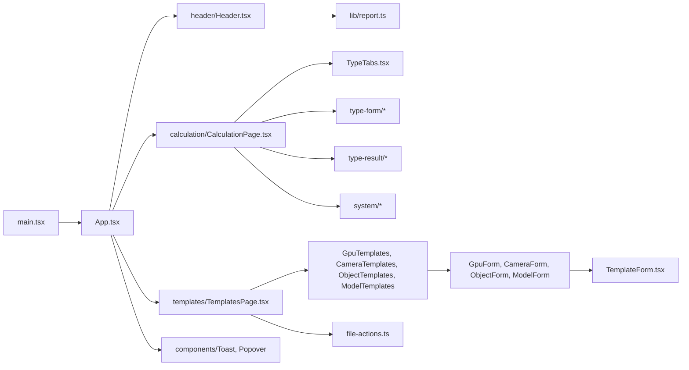
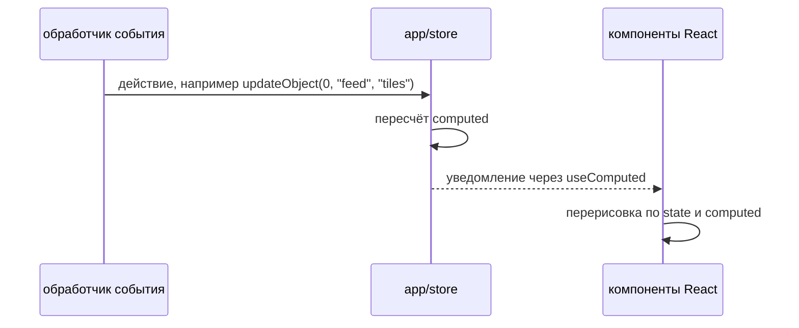

# Модуль ui

Интерфейс на React: шапка, экран расчёта (вкладки типов, форма типа, карточки объектов, результат, панель системы, схема SVG), экраны шаблонов, подсказки, уведомления, тема, язык и маршрутизация по адресу. Состояние модуль берёт из `app` и меняет только через его действия. Тексты берёт из `i18n`, справочники и функции разбора — из `domain`. Решения — в [`../decisions/ui.md`](../decisions/ui.md).

## Раскладка

Папки — по частям экрана, общие компоненты, хуки и функции без React — отдельно. Файл компонента называется как компонент, файл хука — как хук, остальные файлы — в kebab-case.

```
src/ui/
├── App.tsx                  корень: шапка, экран расчёта или шаблонов по адресу, уведомление, подсказка
├── header/                  Header.tsx — тема, язык, шаблоны, пример, копирование отчёта
├── calculation/
│   ├── CalculationPage.tsx  экран расчёта, блок формул
│   ├── TypeTabs.tsx         вкладки типов камер
│   ├── type-form/           TypeForm.tsx, ObjectList.tsx, ObjectCard.tsx
│   ├── type-result/         TypeResult.tsx, SideDiagram.tsx
│   └── system/              SystemPanel.tsx, GpuLoad.tsx, NetworkPanel.tsx, Assumptions.tsx
├── templates/               TemplatesPage.tsx; GpuTemplates.tsx, GpuForm.tsx, GpuParams.tsx;
│                            CameraTemplates.tsx, CameraForm.tsx; ObjectTemplates.tsx, ObjectForm.tsx;
│                            ModelTemplates.tsx, ModelForm.tsx;
│                            CatalogSection.tsx, TemplateForm.tsx; file-actions.ts, form-errors.ts
├── components/              общие: Field.tsx, NumberInput.tsx, Tip.tsx, Popover.tsx, Toast.tsx
├── hooks/                   useComputed.ts, useHashRoute.ts, useConfirm.ts
└── lib/                     функции без React: report.ts, labels.ts, model-input-sizes.ts
```

## Состав

| Файл | Что внутри |
|---|---|
| `App.tsx` | Компонент `App`: `Header`, `CalculationPage` или `TemplatesPage` по адресу после `#`, `Toast` и `Popover`. При смене адреса страница прокручивается в начало |
| `header/Header.tsx` | Компонент `Header`: кнопки темы, языка, экрана шаблонов, примера и «Копировать отчёт». Тему ставит классом `light` на `<html>` |
| `calculation/CalculationPage.tsx` | Компонент `CalculationPage`: разделы экрана расчёта и блок «Все формулы» на языке страницы |
| `calculation/TypeTabs.tsx` | Компонент `TypeTabs`: вкладки типов камер и кнопка нового типа |
| `calculation/type-form/TypeForm.tsx` | Компонент `TypeForm`: форма активного типа — поля, видимость полей по режиму объектива и камере, сводки в заголовках секций, кнопки «копия» и «удалить тип» |
| `calculation/type-form/ObjectList.tsx` | Компонент `ObjectList`: карточки объектов активного типа, кнопка нового объекта, ссылки на вкладки шаблонов «Объекты детекции» и «Модели» |
| `calculation/type-form/ObjectCard.tsx` | Компонент `ObjectCard`: выбор объекта детекции в заголовке карточки, модель, подача, вход модели, перекрытие и результат объекта. Габариты и порог в карточке не показываются и не меняются: они берутся из шаблона |
| `calculation/type-result/TypeResult.tsx` | Компонент `TypeResult`: результат активного типа — вердикт, показатели, плотность, DORI, схема |
| `calculation/type-result/SideDiagram.tsx` | Компонент `SideDiagram`: схема «вид сбоку» в SVG по геометрии из `domain` |
| `calculation/system/SystemPanel.tsx` | Компонент `SystemPanel`: итоги системы — камеры, объекты, вычислитель, сеть |
| `calculation/system/GpuLoad.tsx` | Компонент `GpuLoad`: поля «GPU» и «Количество», кольцо нагрузки по группам запусков, шкалы декодера и памяти, примечание |
| `calculation/system/NetworkPanel.tsx` | Компонент `NetworkPanel`: поле «Архив», поток по типам камер, итог и объём архива |
| `calculation/system/Assumptions.tsx` | Компонент `Assumptions`: пункты списка допущений |
| `templates/TemplatesPage.tsx` | Компонент `TemplatesPage`: вкладки шаблонов `#tpl-gpus`, `#tpl-cams`, `#tpl-objects`, `#tpl-models`, экспорт и импорт; `isTemplateRoute` — адрес экрана шаблонов |
| `templates/GpuTemplates.tsx`, `GpuForm.tsx`, `GpuParams.tsx` | Экран видеокарт: каталог и свои карты с ценой и участием в подборе, форма своей карты, поля КПД и резерва |
| `templates/CameraTemplates.tsx`, `CameraForm.tsx` | Экран камер: встроенные и свои камеры, форма своей камеры |
| `templates/ObjectTemplates.tsx`, `ObjectForm.tsx` | Экран объектов детекции: свои и встроенные объекты, сколько объектов расчёта их ищут, форма своего объекта |
| `templates/ModelTemplates.tsx`, `ModelForm.tsx` | Экран моделей: свои модели и модели каталога, форма своей модели |
| `templates/CatalogSection.tsx`, `TemplateForm.tsx` | Общий каркас экранов шаблонов: раздел с таблицей; форма с подсказкой, ошибкой и кнопками |
| `templates/file-actions.ts` | `downloadState` — все данные в файл, `loadStateFile` — импорт с перезагрузкой страницы |
| `templates/form-errors.ts` | Текст ошибки формы шаблона по ошибкам разбора из `domain` |
| `components/Field.tsx` | Компонент `Field`: подпись поля, кнопка «?» и элемент ввода |
| `components/NumberInput.tsx` | Компонент `NumberInput`: `type="number"`, `min="0"`; `integer` — только целые |
| `components/Tip.tsx`, `Popover.tsx` | Кнопка «?» и подсказка к ней: открывается наведением или фокусом, закрепляется щелчком |
| `components/Toast.tsx` | Компонент `Toast` и функция `toast(text)`: уведомление внизу страницы |
| `hooks/useComputed.ts` | Хук `useComputed`: результаты расчёта из `store`, компонент перерисовывается после каждого действия |
| `hooks/useHashRoute.ts` | Хук `useHashRoute`: адрес после `#`, компонент перерисовывается при его смене |
| `hooks/useConfirm.ts` | Хук `useConfirm`: действие по второму нажатию в течение 3 с — удаление типа, импорт |
| `lib/report.ts` | `reportText(computed)` — текстовый отчёт |
| `lib/labels.ts` | Подписи, общие для результата, панели системы и отчёта: название модели объекта, камера типа |
| `lib/model-input-sizes.ts` | Размеры входа модели для списков в карточке объекта и форме модели |

Точка входа `src/main.tsx` ставит язык и заголовок страницы, подключает сохранение к `store`, загружает сохранение и отрисовывает `App` в `#root` из `index.html`.



На схеме нет общих файлов (`components/Field.tsx`, `NumberInput.tsx`, `Tip.tsx`, `Toast.tsx`, хуки, `lib/labels.ts`): их импортируют многие. Круговых импортов внутри `ui` нет.

## Отрисовка



Компоненты читают `state` и `computed` при отрисовке. Подписка — хук `useComputed` (`useSyncExternalStore`): после каждого действия компонент перерисовывается. Отдельного кода, который переносит значения из состояния в поля и обратно, нет.

- **Поля связаны с состоянием.** Значение поля — из `state`, ввод сразу вызывает действие `store` (`updateActiveType`, `updateObject`, `updateSystem`, `setGpuPrice`). Ширина матрицы, рассчитанная по камере или формату, показывается в поле только для чтения и в состояние не записывается.
- **Формы шаблонов — своё состояние компонента** (`useState`). Строки полей разбирает `domain` при отправке. После добавления шаблона очищаются текстовые поля; списки и флажок остаются.
- **Экраны не размонтируются.** `CalculationPage` и вкладки `TemplatesPage` остаются в разметке и скрываются атрибутом `hidden`: ввод в формах шаблонов не теряется при переходах. Правило `[hidden] { display: none !important }` в `src/styles.css` скрывает и элементы, чей класс задаёт `display`.
- **Первая отрисовка сразу** (`flushSync` в `main.tsx`): когда скрипт выполнен, страница отрисована целиком. Дальше React обновляет страницу после действия в микрозадаче.
- **Уведомление и подсказка** отрисовываются порталом в `<body>`. Их состояние — в модуле компонента: `toast(text)` вызывается и вне компонентов, например из подписчика сохранения в `main.tsx`.

## Соглашения

- **Состояние только через действия.** `ui` читает `state` и `computed` и вызывает действия `store`. Поля `state` в `ui` не присваиваются.
- **Обработчики — в JSX.** `addEventListener` вызывается только для `document` и `window` (закрытие подсказки, смена адреса) в эффектах или подписке хука, со снятием при размонтировании.
- **Работа с DOM вне React — только для элементов вне дерева:** класс темы на `<html>`, язык и заголовок документа, ссылка для скачивания файла. Фокус на выборе объекта детекции в новой карточке — через `ref` после `flushSync`.
- **Подсказки «?».** Кнопку `Tip` у подписи ставит `Field` по параметру `tip` (ключ `STR.tips`). Подсказка `objects` стоит в заголовке раздела объектов, а не у поля.
- **Тексты через `i18n`.** Ключ для `t()` проверяет `tsc`. Текст, в который встраивается элемент (моноширинный размер в результате объекта), собирается из частей строки словаря по метке.
- **HTML в разметку — только статичные формулы** `src/formulas*.html` (`dangerouslySetInnerHTML`): в них нет данных пользователя.
- **Отчёт по нажатию.** `reportText` строится из `computed` при нажатии «Копировать отчёт». Между нажатиями текст отчёта нигде не хранится.

## Проверки

| Проверка | Что проверяет |
|---|---|
| `tsc` | Типы `ui`: поля результатов `domain`, параметры действий `store`, ключи и параметры `t()`, свойства компонентов |
| `tests/page/` | Страница в jsdom: отчёт, шаблоны, формы, импорт и экспорт, язык. `App` отрисовывает Testing Library, действия идут через `fireEvent`, см. [`build.md`](build.md#проверки) |
| `tests/golden/` | Результаты расчёта на странице совпадают с `tests/golden/golden.txt` |

Отсутствие присваиваний полям состояния в `ui` проверяется поиском:

```bash
grep -rnE "(state|type|obj|object|detector|gpu|camera|inputs)(\.[A-Za-z_]+|\[[^]]+\])+ *(=[^=>]|\+\+|--|\+=|-=)|\.(push|splice|pop|shift|unshift|sort|reverse)\(|delete [a-z]" src/ui src/main.tsx
```

Отсутствие ручной работы с элементами React — поиском:

```bash
grep -rnE "innerHTML|addEventListener|getElementById|querySelector" src/ui
```

Он находит только подписки на `document` и `window` в `Popover.tsx` и `useHashRoute.ts` и поиск поля в новой карточке объекта в `ObjectList.tsx`.
